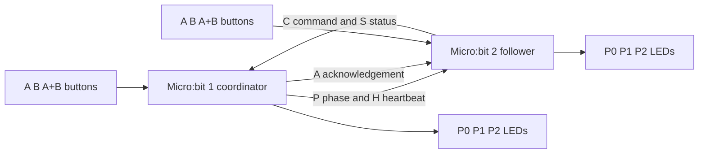

# Architecture

## Topology and authority

SmartTraffic has two micro:bit nodes in radio group 138. Both use the same P0/P1/P2 LED wiring.

- **Micro:bit 1 is the coordinator.** It is the only timing authority, advances the phase state machine, applies phases to its local outputs and broadcasts state.
- **Micro:bit 2 is the follower.** It applies the latest valid coordinator phase and never advances phase timing on its own.
- Either device accepts A (start), B (stop) and A+B (switch external LEDs off). Follower controls become radio commands. Coordinator controls are handled locally.

Keeping a single phase clock avoids contradictory transitions. It does not make radio delivery reliable or the display fail-safe.

## Data flow

The source files are intentionally standalone so each can be copied into its own MakeCode Python project: `src/microbit_1.py` and `src/microbit_2.py`.

## Event handling and timing

Radio and button callbacks only place a value in a one-item buffer. The 20 ms main loop processes those values, advances coordinator timing, checks timeouts and schedules status messages. Phase changes use `control.millis()` elapsed time; no multi-second phase delay blocks button or radio handling.

The follower refreshes its communication timer on each new valid coordinator packet. If no such packet arrives for 1.8 seconds, it switches its external output to red. A later valid packet can restore synchronization. This fallback is a simulation behavior, not a safety guarantee.

## Failure behavior

| Condition | Behavior |
| --- | --- |
| Malformed packet or wrong protocol prefix | Ignore it |
| Duplicate phase/heartbeat/status sequence | Ignore it |
| Duplicate command sequence | Re-acknowledge without applying the command again |
| Unknown coordinator phase | Follower displays red |
| Follower loses coordinator packets | Follower displays red after timeout and resets its receive sequence window for later recovery |
| Follower command receives no acknowledgement | Retry the same packet up to four total sends, then display red |
| Coordinator has not heard follower status | Internal `follower_connected` diagnostic becomes false; coordinator still owns timing |
| Device restart | Both programs initialize their outputs to red; coordinator starts stopped |

Messages can be lost, delayed or overwritten by the one-item callback buffer. Heartbeats allow the follower to recover the current phase; commands use acknowledgements and retries to reduce missed requests.

## Design decisions

- **Coordinator authority:** only one phase clock exists.
- **Elapsed time:** phase timing is responsive to input and radio events.
- **Fixed packet header and sequence field:** simple to inspect and validate.
- **Red fallback:** a visible conservative simulation state for common communication errors.
- **No sensors or extra display:** the project uses only the documented LEDs, built-in buttons and radio.
- **No safety claims:** software fallback cannot guarantee safe electrical or traffic behavior.
