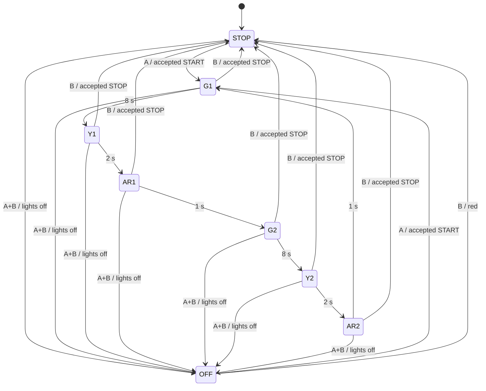

# State machine

Micro:bit 1 is the sole phase clock. Each transition is based on elapsed milliseconds from `control.millis()`; the main loop continues to process button and radio events during every phase.

## States and durations

| State | Direction 1 (micro:bit 1) | Direction 2 (micro:bit 2) | Time before next phase |
| --- | --- | --- | ---: |
| `G1` | Green | Red | 8,000 ms |
| `Y1` | Yellow | Red | 2,000 ms |
| `AR` after `Y1` | Red | Red | 1,000 ms |
| `G2` | Red | Green | 8,000 ms |
| `Y2` | Red | Yellow | 2,000 ms |
| `AR` after `Y2` | Red | Red | 1,000 ms |
| `STOP` | Red | Red | No automatic transition |
| `OFF` | All external LEDs off | All external LEDs off | No automatic transition |

`AR` is one protocol/display state used twice per cycle. Its position is known to the coordinator from the preceding phase.

## Transitions

- Power-up starts in `STOP`; both devices initialize to red.
- A local A press on either device starts (or requests) the sequence at `G1`.
- A local B press stops (or requests stop); both devices display red.
- A local A+B chord switches off all external LEDs.
- While running, the coordinator follows `G1 → Y1 → AR → G2 → Y2 → AR → G1`.
- The coordinator broadcasts each phase change and a heartbeat every 500 ms.
- The follower displays only valid, newer coordinator state. It does not independently time phase changes.
- On unknown coordinator state, stale link timeout, or exhausted command retries, the follower displays red. A subsequent valid phase packet can resynchronize it.

## State diagram

The diagram names the two occurrences `AR1` and `AR2` for readability; firmware sends `AR` for both.

## Timing and limitations

The default durations are demonstration settings and should be changed only for controlled educational experiments. They have no relationship to road engineering, pedestrian clearance or legal signal timing. The follower's display may lag or show red when radio messages are lost. See [Safety](SAFETY.md).
